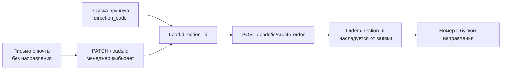

# Производственные направления

Реализует пункты 2 и 3 технического задания заказчика.

## Что просило ТЗ

> Заявки должны фиксироваться как: Эмаль (номер), Пвх (номер и буква «П»), Шпон (номер и буква «Ш»).
>
> Карточка клиента: ФИО, организация, адрес, телефон, История заказов (дата, сумма, состав).

## Направление — справочник, а не перечисление в коде

`production_directions` — таблица, потому что заказчик добавляет направление сам,
без правки кода и релиза. Четвёртое направление (акрил, массив) заводится через
`POST /directions`.

| Поле | Назначение |
| --- | --- |
| `code` | машинный код: `enamel`, `pvc`, `veneer`. На него ссылается API |
| `name` | человеческое имя: «Эмаль», «ПВХ», «Шпон» |
| `number_suffix` | буква в номере заказа: пусто, «П», «Ш» |
| `sort_order` | порядок в списках и отчётах |
| `is_active` | выключенное направление не предлагается в формах, но старые заказы остаются |

Три направления создаёт **миграция** `0007`, а не сид: без них не работает
нумерация заказов, а сид на прод-сервере не запускается.

## Нумерация заказов

```
0001      эмаль
0002-П    ПВХ
0003-Ш    шпон
```

Счётчик **сквозной по всем направлениям** — буква отличает направление, а не
начинает отдельную последовательность. Так номер остаётся уникальным сам по
себе: «0002-П» и «0002» не могут существовать одновременно, и в разговоре по
телефону номер не двоится.

Если номер уже занят (например, после переноса данных), `_generate_order_number`
сдвигает счётчик до свободного.

Формат меняется через `number_suffix`: сменить «-П» на «П» — правка одной строки
в `DirectionService.format_order_number`. Правило выбора буквы живёт там же и
только там: когда оно было продублировано в `orders/service.py`, две копии
успели разойтись и буква терялась.

### Откуда берётся буква

1. **Буква направления**, если она у него есть: ПВХ — «П», шпон — «Ш».
2. Если у направления буквы нет (эмаль — это «1024» и есть), букву даёт
   **основная операция заявки**: фрезеровка — «Ф», мыло — «М». Заказчик:
   «в зависимости от фрезы, мыла, шпона присваивалась к цифрам буква». Без
   этого пачку эмали с фрезеровкой в цехе не отличить от обычной эмали.
3. Ни того, ни другого — просто номер.

Основную операцию выбирают голосованием по строкам заявки, и строки,
повторяющие само направление, в нём **не участвуют**: у заявки «Эмаль» тип
работ `paint` стоит у обычных фасадов и ничего нового не сообщает. Пока такие
строки голосовали наравне, буква зависела от их количества — менеджер дописывал
артикул руками, и номер заказа менялся.

Свой номер студии («44 03 п») буквой не дополняется: его берут как есть.

### Ручной номер

Номер можно назвать самому и при создании заявки, и при создании заказа —
студия ведёт свою нумерацию и переносит её в систему задним числом. Пустое
поле означает «поставь сам». Занятый номер отклоняется с 409: два заказа с
одним номером в цеху означают, что по бумажке невозможно понять, какой резать.

## Как направление попадает в заказ



- **Ручной ввод** — менеджер указывает направление сразу: `direction_code` в `UnifiedLeadIn`.
- **Письмо с почты** — направления нет, его не определить из текста надёжно. Менеджер
  прочитал письмо и выставил направление через `PATCH /leads/{id}`.
- **Заказ из заявки** наследует направление, поэтому номер получает нужную букву.

Направление **опционально** на обоих уровнях. Заказы, созданные до внедрения
справочника, и заявки, которые менеджер ещё не разобрал, остаются без него и
получают номер без буквы.

## Карточка клиента

`GET /clients/{id}` возвращает `ClientDetailRead`: реквизиты, историю заказов и
сводку покупок.

| Блок | Содержимое |
| --- | --- |
| Реквизиты | ФИО, **организация**, адрес, телефон, почта, комментарий |
| `order_history` | по каждому заказу: номер, дата, направление, состав, статус, сумма |
| `totals` | число заказов, сумма покупок, первый и последний заказ, **дней без заказа** |

`items_summary` — состав одной строкой: «Фасад 716×396, Фасад 716×296 и ещё 4».
Больше трёх позиций не печатается, остальное сворачивается в счётчик.

`totals` — это заготовка отчётов ТЗ «кто давно не покупал» (`days_since_last_order`)
и «сумма покупок за период» (`total_amount`). Сами отчёты появятся в этапе 4.

## Эндпоинты

| Метод | Путь | Право | Назначение |
| --- | --- | --- | --- |
| `GET` | `/directions` | вход в систему | справочник, `?only_active=true` для форм |
| `POST` | `/directions` | `orders.manage` | новое направление |
| `PATCH` | `/directions/{id}` | `orders.manage` | переименовать, выключить |
| `PATCH` | `/leads/{id}` | вход в систему | направление, статус, ответственный |
| `GET` | `/leads?direction_code=pvc` | вход в систему | заявки одного направления |
| `GET` | `/clients/{id}` | вход в систему | карточка с историей заказов |
| `PATCH` | `/clients/{id}` | вход в систему | правка реквизитов, включая организацию |

Буква направления уникальна: попытка завести второе направление с «П» вернёт 409
с указанием, кто её уже занял. Иначе номера заказов стали бы неразличимы.

## Изменение формата номера заказа

Формат `order_number` изменился с `ORD-20260804-0001` на `0001` / `0001-П`.
Это требование ТЗ, а не побочный эффект. Тип поля (строка) и все эндпоинты
остались теми же; обновлён тест `test_create_order_from_lead`.

Старые номера в существующей базе миграция **не переписывает** — они остаются
как есть, новые выдаются в новом формате. Переписывать историю заказов на
работающем производстве опаснее, чем иметь два формата в архиве.

## Русские названия справочников

Миграция `0008` переводит колонки `name` в `order_statuses`, `work_centers`,
`workflow_stages`, `production_workflows`, `roles`, `materials`,
`edge_materials`, `hardware`, `product_templates`.

**Колонки `code` остаются английскими** — на них завязаны обращения к API,
фильтры и переходы по статусам. Меняется только то, что видит человек.

## Регистронезависимый поиск по русским словам

`app/db/sqlite_unicode.py` подменяет `lower()` и `upper()` в SQLite питоновскими
реализациями. Встроенные функции SQLite меняют регистр только у латиницы, из-за
чего поиск «кузнецов» не находил «Кузнецов» — при том что на PostgreSQL то же
самое работало правильно. Расхождение было тихим: на разработке поиск выглядел
сломанным, на проде — рабочим.

## Связанные документы

- [domain.md](domain.md)
- [api.md](api.md)
- [email-channel.md](email-channel.md)
