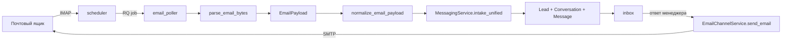

# Email-канал (IMAP + SMTP)

Первый настоящий транспорт платформы. Письма с почтового ящика автоматически
превращаются в заявки и диалоги, ответ менеджера из inbox уходит клиенту письмом.

## Как это работает



Ключевое: intake-ядро не изменилось. Poller приводит письмо к существующему
`EmailPayload` и отдаёт его в тот же `normalize_email_payload`, которым
пользуется эндпоинт `POST /messaging/email/intake`.

## Процессы

| Процесс | Команда | Роль |
| --- | --- | --- |
| `backend` | `uvicorn app.main:app` | API, ручной опрос и health-check |
| `worker` | `python -m app.workers.worker` | выполняет RQ-джобы опроса |
| `scheduler` | `python -m app.workers.scheduler` | ставит джобы в очередь по расписанию |

В docker-compose все три уже описаны. Для локального запуска на Windows есть
inline-режим: `CHANNEL_POLL_INLINE=true` заставляет планировщик выполнять опрос
прямо в своём процессе, без Redis и воркера. Это нужно ещё и технически —
библиотека `rq` использует fork-контекст multiprocessing и на Windows не
импортируется вовсе.

```powershell
.\scripts\run-local.ps1 -WithChannelPoller
```

`scheduler` каждые `CHANNEL_SCHEDULER_TICK_SECONDS` секунд ищет активные
email-каналы, у которых наступил `next_poll_at`, и ставит для каждого джобу
`poll_email_account`. `next_poll_at` сдвигается в момент постановки в очередь, а
не в момент выполнения — поэтому зависший воркер не приводит к лавине
дублирующих джоб.

Интервал опроса задаётся на канале (`poll_interval_seconds`) и ограничен снизу
значением `CHANNEL_POLL_MIN_INTERVAL_SECONDS`.

## Настройка канала

Страница `/admin/channels` → «Подключить почту». Права — `channels.manage`.

Поля:

| Блок | Поле | Комментарий |
| --- | --- | --- |
| Основное | код, название, менеджер по умолчанию | код неизменяем после создания |
| IMAP | host, port, SSL, логин, пароль, папка | для Яндекс/Mail.ru нужен пароль приложения, не основной пароль |
| SMTP | host, port, режим шифрования, логин, пароль, адрес и имя отправителя | без SMTP канал только принимает письма |
| Опрос | интервал, глубина выборки, «только непрочитанные», «помечать прочитанными» | глубина выборки применяется, только когда выключен режим «только непрочитанные» |

Пример для Яндекс.Почты:

```
IMAP: imap.yandex.ru : 993, SSL
SMTP: smtp.yandex.ru : 465, SSL
Логин: sales@example.com
Пароль: пароль приложения из настроек аккаунта
```

После сохранения — кнопка «Проверить соединение»: она логинится на IMAP и SMTP
и возвращает отдельный статус по каждому транспорту. Кнопка «Забрать письма
сейчас» выполняет опрос синхронно, не дожидаясь планировщика.

## Хранение паролей

Пароли шифруются симметрично (Fernet) ключом `CHANNEL_SECRET_KEY` и лежат в
`channel_accounts.secrets_json`. Эта колонка **никогда** не сериализуется в API:
`ChannelAccountRead` отдаёт только `configured_secrets` — список имён заданных
секретов, без значений.

Правила эксплуатации:

- `CHANNEL_SECRET_KEY` задаётся в env до сохранения первых реальных паролей.
- Смена ключа делает уже сохранённые секреты нечитаемыми — их нужно ввести заново.
- Пустое поле пароля в форме означает «оставить текущий», а не «стереть».

## Дедупликация

Первичный ключ дедупликации — заголовок `Message-ID`, он кладётся в
`external_message_id`.

Три уровня защиты от дублей:

1. Poller до разбора вложений проверяет, есть ли уже `Message` с таким
   `external_message_id` и каналом `email`.
2. `LeadService.intake_lead` возвращает существующий lead по паре
   (`source_channel`, `external_message_id`).
3. `InboxService.record_inbound_lead` находит существующее сообщение и не
   создаёт второе.

Если у письма нет `Message-ID` (редкость), poller подставляет синтетический
`imap:<код канала>:<uid>`.

## Несколько ящиков

`UnifiedLeadIn.channel_account_code` проставляется поллером, поэтому письмо
всегда попадает в тот канал, который его забрал. Без этого поля intake
привязался бы к первому активному каналу того же типа.

## Ответ из inbox

`InboxService.create_outbound_message` вызывает `outbound.dispatch_reply`:

- канал не настроен как реальный транспорт → статус `mock_sent`, поведение как
  раньше (нужно для manual/demo-каналов, их тесты не тронуты);
- канал настроен → письмо уходит по SMTP, статус `sent`, `delivered_at`
  заполнен, `Message-ID` ответа сохраняется в `external_message_id`;
- SMTP-ошибка → сообщение всё равно сохраняется со статусом `failed` и текстом
  ошибки в `delivery_error`, диалог остаётся в статусе `needs_reply`, а запрос
  возвращает 502 с понятным сообщением.

Тема ответа — `Re: <тема диалога>`, заголовки `In-Reply-To`/`References`
проставляются по последнему входящему письму, поэтому ответ склеивается в одну
цепочку в почтовом клиенте получателя.

## Вложения

Вложения (и inline-части с именем файла) декодируются в base64 и сохраняются
существующим storage через `LeadService._save_attachment`, затем копируются в
`message_attachments`. Файлы больше `EMAIL_MAX_ATTACHMENT_MB` записываются
метаданными без содержимого — большое письмо не блокирует создание заявки.
Имена файлов очищаются от путей (`../../etc/passwd` → `passwd`).

## Разбор писем

`app/modules/messaging/email_parser.py` построен на stdlib `email`, а не на
IMAP-клиенте: он принимает сырые байты, поэтому тестируется без сети и моков.

Что умеет:

- RFC 2047 в темах и именах файлов (`=?utf-8?B?...?=`), кириллица;
- multipart с выбором `text/plain`, а при его отсутствии — конвертация
  `text/html` в текст собственным `HTMLParser` (без новых зависимостей);
- любые кодировки частей с `errors="replace"`;
- битый заголовок `From:` не роняет опрос — адрес просто остаётся пустым.

## Переменные окружения

| Переменная | По умолчанию | Назначение |
| --- | --- | --- |
| `CHANNEL_SECRET_KEY` | `change-me` | ключ шифрования секретов каналов |
| `CHANNEL_POLL_DEFAULT_INTERVAL_SECONDS` | `120` | интервал для каналов без своей настройки |
| `CHANNEL_POLL_MIN_INTERVAL_SECONDS` | `30` | нижняя граница интервала |
| `CHANNEL_SCHEDULER_TICK_SECONDS` | `15` | период тика планировщика |
| `CHANNEL_POLL_INLINE` | `false` | опрашивать в процессе планировщика, без RQ |
| `EMAIL_POLL_BATCH_LIMIT` | `25` | писем за один опрос |
| `EMAIL_MAX_ATTACHMENT_MB` | `15` | порог сохранения содержимого вложения |
| `EMAIL_CONNECT_TIMEOUT_SECONDS` | `20` | таймаут IMAP/SMTP |

## Эндпоинты

| Метод | Путь | Право | Назначение |
| --- | --- | --- | --- |
| `GET` | `/messaging/channel-accounts` | `channels.manage` | список каналов со статусами опроса |
| `POST` | `/messaging/channel-accounts` | `channels.manage` | создать канал (с секретами) |
| `PATCH` | `/messaging/channel-accounts/{id}` | `channels.manage` | изменить канал/секреты |
| `POST` | `/messaging/channel-accounts/{id}/health-check` | `channels.manage` | проверить IMAP и SMTP |
| `POST` | `/messaging/channel-accounts/{id}/poll` | `channels.manage` | забрать письма немедленно |

Существующие эндпоинты intake и inbox не изменились.

## Диагностика

| Симптом | Где смотреть |
| --- | --- |
| письма не приходят | карточка канала: `Последний опрос`, `Последняя ошибка`; работает ли процесс `scheduler` |
| «Ошибка IMAP: authentication failed» | пароль приложения, а не основной пароль; включён ли IMAP у провайдера |
| письма приходят один раз и перестают | включён режим «только непрочитанные» + «помечать прочитанными»; письма читают в веб-интерфейсе почты |
| ответ не уходит | заполнены ли SMTP host и адрес отправителя, задан ли `smtp_password` |
| «Не удалось расшифровать секрет канала» | сменился `CHANNEL_SECRET_KEY` — введите пароли заново |

## Связанные документы

- [intake.md](intake.md)
- [inbox.md](inbox.md)
- [architecture.md](architecture.md)
