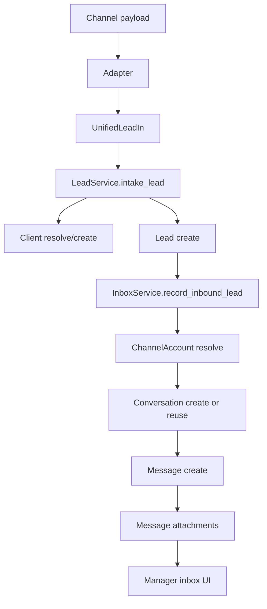

# Omnichannel Inbox

## Зачем нужен отдельный inbox

`Lead` фиксирует факт входящей заявки и запускает бизнес-процесс.

Этого недостаточно для реальной работы менеджера, потому что в живом процессе нужны:

- история сообщений по одному клиенту
- вложения и метаданные канала
- назначение ответственного менеджера
- статус диалога
- возможность ответить клиенту из CRM
- связка `conversation -> lead -> order`

Поэтому в системе введен отдельный коммуникационный слой:

- `channel_accounts`
- `conversations`
- `messages`
- `message_attachments`

## Модель данных

### `channel_accounts`

Хранит конфигурацию канала связи:

- тип канала: `email`, `telegram`, `telegram_bot`, `whatsapp`, `webhook`, `website_form`, `manual_manager_input`
- режим приема: `webhook`, `polling`, `manual`, `form_post`
- дефолтного менеджера
- техническую конфигурацию в `config_json` (открытая часть, видна в API)
- учётные данные в `secrets_json` — зашифрованы Fernet, **никогда не отдаются
  в API**; наружу выходит только `configured_secrets` со списком имён
- операционное состояние опроса: `next_poll_at`, `last_polled_at`,
  `last_success_at`, `last_error`, `last_error_at`, `poll_cursor`

Примеры:

- `email_sales`
- `telegram_main_bot`
- `whatsapp_business_main`
- `website_form_default`

### `conversations`

Хранит карточку диалога:

- канал
- контакт клиента
- привязанный `client`
- основной `lead`
- назначенного менеджера
- статус диалога
- счетчик непрочитанных
- превью последнего сообщения

### `messages`

Хранит сообщения в диалоге:

- `direction`: `inbound` / `outbound`
- `source_channel`
- `external_message_id`
- текст
- нормализованный текст
- сырой payload
- автора/отправителя
- статус доставки исходящего: `mock_sent` (транспорт не настроен), `sent`,
  `failed`, плюс `delivered_at` и `delivery_error`

### `message_attachments`

Хранит вложения сообщения.

На старте вложения переиспользуют уже сохраненные файлы из lead intake.

## Текущий flow

## Как потом подключать реальные каналы

### Email — реализовано

Подробности: [email-channel.md](email-channel.md).

Кратко:

1. Выделенный почтовый ящик, например `sales@company.ru`
2. Процесс `app.workers.scheduler` ставит RQ-джобу `poll_email_account` по
   расписанию канала, воркер её выполняет
3. Парсер (stdlib `email`) извлекает `message_id`, `subject`, `from_name`,
   `from_email`, `body_text`, вложения — с поддержкой multipart, кириллицы и
   HTML→текст
4. Данные приводятся к `UnifiedLeadIn` тем же `normalize_email_payload`
5. `InboxService` сохраняет это как conversation/message
6. Ответ менеджера уходит по SMTP c корректными `In-Reply-To`/`References`

Дедупликация — по `Message-ID`. Состояние опроса (последний UID, время, ошибка)
хранится на `channel_accounts` и видно на карточке канала в `/admin/channels`.

Осталось на будущее: retry с backoff и dead-letter для писем, которые стабильно
не разбираются.

### Telegram

Практический путь:

1. Создается bot через BotFather
2. Включается webhook на `POST /api/v1/messaging/telegram/bot/telegram-api`
3. Входящие сообщения идут в `MessagingService` / `InboxService`
4. Исходящие сообщения отправляются через отдельный `TelegramDispatcher`

Что уже есть:

- demo bot flow
- webhook-ready endpoint
- хранение bot session

Что еще нужно добавить:

- реальную отправку через `https://api.telegram.org/bot<TOKEN>/sendMessage`
- отправку media/messages/keyboard из CRM
- обработку ошибок Telegram API

### WhatsApp Business API

Практический путь:

1. Использовать Meta Cloud API или BSP-провайдера
2. Принять webhook входящих сообщений
3. Нормализовать payload в `UnifiedLeadIn`
4. Сохранить в `conversations/messages`
5. Для ответа из CRM использовать отдельный `WhatsAppDispatcher`

Что важно понимать:

- WhatsApp Business не подключается как обычный “бот”
- нужен официальный API или BSP
- нужно хранить `wa_id`, conversation state и шаблоны сообщений

### MAX или другой корпоративный мессенджер

Если у канала есть API/webhook:

1. пишется adapter
2. payload приводится к `UnifiedLeadIn`
3. исходящие реализуются через dispatcher-интерфейс

Если API нет, канал нельзя полноценно автоматизировать на уровне inbox.

## Что уже сделано в коде

- новые таблицы и migration для inbox foundation
- автоматическое создание/переиспользование conversation при intake
- список диалогов `/inbox`
- карточка диалога `/inbox/[id]` со статусом доставки исходящих
- реальная отправка ответа по email, mock-ответ для каналов без транспорта
- dispatcher исходящих (`messaging/outbound.py`)
- admin-страница каналов `/admin/channels`: форма настройки, health-check,
  ручной опрос, статус и последняя ошибка на карточке

## Что осталось сделать

### Ближайший этап

- реальные adapters для Telegram (фаза 2) и WhatsApp (фаза 3)
- assignment UI для менеджеров
- статусная модель диалогов `new / in_progress / waiting_customer / qualified / closed`

### Следующий этап

- шаблоны ответов
- теги и классификация диалогов
- SLA по ответу
- привязка нескольких lead/order к одному диалогу
- полнотекстовый поиск по сообщениям

## Принцип интеграции

Ключевая идея:

- канал отвечает только за прием/отправку transport-данных
- CRM не знает деталей Telegram/WhatsApp/email протокола
- внутренняя работа идет через общие модели `UnifiedLeadIn`, `Conversation`, `Message`

Это и есть тот уровень абстракции, после которого можно “просто подключить” почту, Telegram или WhatsApp без переделки доменной модели CRM.
