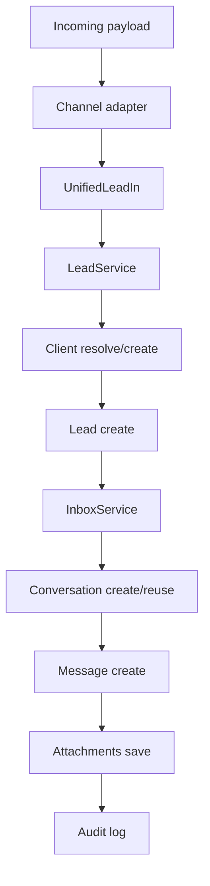

# Intake

## Цель

Свести все источники заявок к одной доменной модели `UnifiedLeadIn`, а затем автоматически:

- найти или создать клиента
- создать `Lead`
- привязать коммуникацию к `Conversation`
- сохранить вложения
- записать аудит

## Поддерживаемые каналы

- website form
- email
- Telegram webhook
- Telegram bot
- WhatsApp Business API webhook
- generic webhook source
- manual manager input

## Базовый pipeline



## Что такое `UnifiedLeadIn`

Это единый входной контракт для всех каналов.

Ключевые поля:

- `source_channel`
- `external_message_id`
- `subject`
- `text`
- `sender`
- `attachments`
- `raw_payload`

## Пример unified payload

```json
{
  "source_channel": "website_form",
  "external_message_id": "site-2026-000123",
  "subject": "Запрос на шкаф-купе",
  "text": "Нужен шкаф 1800x2400x600, клиент Иван Петров, телефон +79991234567, email ivan@example.com",
  "sender": {
    "full_name": "Иван Петров",
    "phone": "+79991234567",
    "email": "ivan@example.com",
    "external_id": "site-user-42"
  },
  "attachments": [
    {
      "file_name": "sketch.pdf",
      "mime_type": "application/pdf",
      "size_bytes": 84522,
      "external_url": "https://example.com/sketch.pdf"
    }
  ],
  "raw_payload": {
    "utm_source": "google",
    "page": "/wardrobes",
    "comment": "Связаться после 15:00"
  }
}
```

## Как работает intake сейчас

### Шаг 1. Нормализация канала

Каждый adapter приводит исходный payload к `UnifiedLeadIn`.

Примеры:

- email adapter извлекает `subject`, `body_text`, `from_email`, attachments
- telegram adapter извлекает `message.text`, `from`, `chat`, media
- whatsapp adapter извлекает `contacts`, `messages`, media

### Шаг 2. Нормализация бизнес-данных

`LeadService` извлекает:

- `client_name`
- `client_id` (из `sender.client_id`, если менеджер выбрал клиента из базы)
- `phone`
- `email`
- `text`
- `dimensions`

### Шаг 3. Разрешение клиента

Порядок в `LeadService._resolve_client`:

1. `sender.client_id` — менеджер выбрал клиента в подсказке формы заявки. Это
   точнее любого поиска по контактам и работает даже для карточки без телефона
   и почты. Несуществующий id игнорируется, разрешение идёт дальше.
2. Поиск по email и/или phone (`ClientRepository.find_by_contact`): почта
   сравнивается без учёта регистра, телефон — по одним цифрам, поэтому
   «8 (999) 123-45-67» и «+7 999 123-45-67» — один клиент. Короткие номера
   (меньше 5 цифр) слишком легко совпадают с чужими и по ним привязка не идёт.
   Из нескольких совпадений берётся самая ранняя карточка, чтобы история
   собиралась на первом заведённом клиенте, а не на дубле.
3. Если никто не найден, создаётся новый `Client`.

Подсказка «ФИО из базы» в форме заявки ходит в существующий
`GET /api/v1/clients?search=`: он ищет по имени, организации, почте и телефону,
причём телефон сравнивается и по одним цифрам (`app/modules/clients/phones.py`).

### Шаг 4. Создание lead

Создается `Lead` со статусом `new`, raw/normalized текстом и parsed payload.

### Шаг 5. Синхронизация с inbox

`InboxService`:

- подбирает `ChannelAccount`
- создает или переиспользует `Conversation`
- добавляет `Message`
- переносит вложения в `message_attachments`

## Почему нужен отдельный inbox

Если хранить только `Lead`, то теряется важный слой операционной работы:

- история сообщений
- непрочитанные диалоги
- назначение менеджера
- статус диалога
- исходящие ответы

Поэтому `Lead` и `Conversation` живут рядом:

- `Lead` нужен для бизнес-процесса CRM
- `Conversation` нужен для коммуникации

## Адаптеры

### Email

Реализовано и работает на живом ящике (см. [email-channel.md](email-channel.md)):

- IMAP poller как RQ-джоба, расписание — процесс `app.workers.scheduler`
- разбор письма в `EmailPayload` (multipart, кириллица, HTML→текст, вложения)
- дедупликация по `Message-ID` → `external_message_id`
- ответ менеджера из inbox уходит по SMTP

Poller не трогает intake-ядро: он приводит письмо к тому же `EmailPayload`,
который принимает эндпоинт `POST /messaging/email/intake`, и вызывает
`normalize_email_payload`.

Альтернатива, пока не реализованная, — inbound webhook от почтового провайдера.

### Telegram

Практический путь:

- bot webhook
- direct webhook для обычных сообщений

### WhatsApp

Практический путь:

- Meta Cloud API или BSP
- входящий webhook

### Generic webhook

Используется для:

- внешних лид-форм
- партнерских сайтов
- внутренних интеграций

## Дополнительное поле `channel_account_code`

Каналы, которые сами забирают сообщения (сейчас — email poller), проставляют в
`UnifiedLeadIn.channel_account_code` код аккаунта, который получил сообщение.
`InboxService` привязывает диалог именно к нему. Без этого поля intake выбирает
первый активный аккаунт нужного типа — что ломается, как только ящиков
становится два (например `sales@` и `info@`).

Поле опционально: payload без него обрабатывается ровно как раньше.

## Номер заявки и сводка

### Номер

У заявки есть человеческий номер вида **«З-0001»** (поле `lead_number`).
Нумерация сквозная и **своя, отдельная от заказов**: у заказов номер выглядит как
`0012` / `0012-П` / `0012-ОШ`, и общий счётчик означал бы, что `0012` — это то
заказ, то заявка. Занятые номера пропускаются, как и в `OrderService`.

Номер нужен потому, что менеджер называет его клиенту по телефону: ссылка на UUID
для этого не годится. Он выводится в списке заявок, в диалогах, на карточке и
сразу после создания заявки.

Существующие заявки пронумерованы миграцией `0011_lead_number` по дате создания.

### Сводка

`GET /leads/{id}` и `POST /leads/intake` возвращают блок `summary`
(`LeadService.build_summary`). Порядок источников важен:

1. **Готовый расчёт** — если заявка пришла из справочника или из бота, в
   `raw_payload.estimate` уже лежат `area_sqm`, `material_area_sqm` и
   `final_amount`, посчитанные по правилам изделия. Берём их.
2. **Список позиций** `raw_payload.parts` — заявка почти всегда содержит
   несколько разных размеров. Площадь складывается по позициям. Умножать первый
   размер на общее количество нельзя: для `560x123x3` и `610x120x5` это дало бы
   0.551 м² вместо верных 0.573 м².
3. **Один разобранный размер** — если ничего выше нет, считаем по
   `dimensions` × `quantity`.

`material_area_sqm` умножается на `material_area_factor` направления: у ПВХ он
равен 2, потому что плёнка клеится с двух сторон.

`estimated_amount` появляется **только если расчёт действительно был** — сумму
«на глазок» здесь не выдумываем. Фактические деньги приходят в `orders_amount`
и `orders_count`, когда из заявки создан заказ.

Сводка считается на карточке и после создания, но **не в списке заявок**: там она
не нужна, а загрузка заказов на каждую строку дала бы запрос на запрос.

### Ввод размеров списком

Форма заявки на `/manager` принимает размеры так же, как раскрой: одна строка —
длина, ширина, количество (`560 123 3`, `560x123x3`, `560*123`). Разбор живёт в
`frontend/lib/format.ts` → `parseSizeLines`, один и тот же для формы и карты
раскроя — иначе у менеджера было бы два разных формата ввода.

Разобранные позиции уходят в `raw_payload.parts`, а раскрой открывается прямо от
заявки: `/film-cutting?leadId=<id>`.

### Имя клиента без имени

Если клиент не назвал себя, подставляется русская заглушка по каналу
(`LeadService._placeholder_client_name`): «Клиент с сайта», «Клиент с почты»,
«Клиент без имени». До этого в базу попадало `Client from manual_manager_input`,
и менеджер не мог ни прочитать это, ни назвать по телефону.

## Что уже есть в коде

- unified intake endpoints
- adapters для email / Telegram / WhatsApp / generic webhook
- `Conversation`, `Message`, `MessageAttachment`, `ChannelAccount`
- страницы `/inbox` и `/inbox/[id]`
- admin-страница `/admin/channels` с формой канала и health-check
- **email**: реальный IMAP poller, SMTP-отправка, шифрование учётных данных,
  delivery status по исходящим
- номер заявки «З-0001», сводка по площади и деньгам, ввод размеров списком,
  переход в раскрой прямо из заявки

## Что осталось добавить

- реальный транспорт Telegram (фаза 2)
- реальный транспорт WhatsApp через провайдера (фаза 3)
- шаблоны ответов
- множественные связи conversation <-> lead/order

## Связанные документы

- [email-channel.md](email-channel.md)
- [inbox.md](inbox.md)
- [telegram-bot.md](telegram-bot.md)
- [api.md](api.md)
